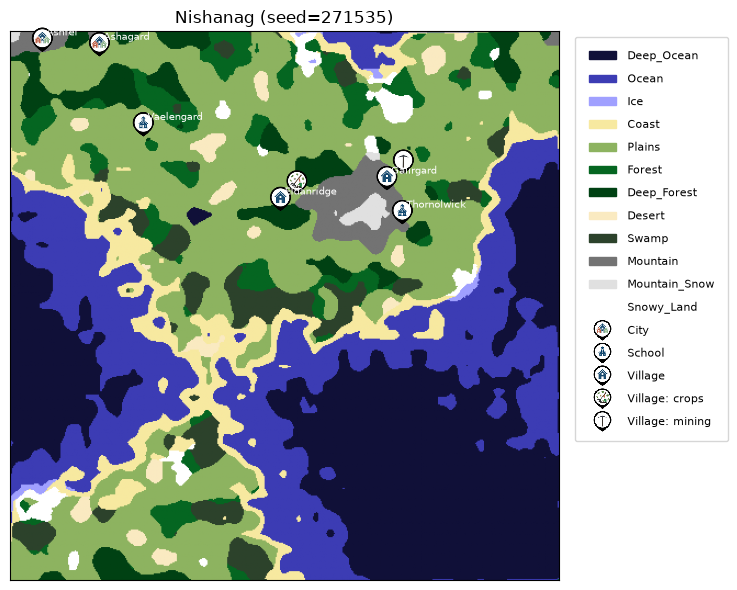

# Carto

A procedural fantasy map generator. Carto grows terrain from a seed, sorts it into biomes, scatters named settlements across the land, and draws the result as a chart you can download. It runs as a web app and as a command-line tool.

**Live demo:** https://carto-fantasy-map-generator.onrender.com/

## Demo Output:

- for seed 271535 and other details default
  

**Note:** The demo runs on a free hosting tier, so the first visit after a quiet period can take up to a minute to wake the server. Saved maps are cleared whenever the service restarts or redeploys.

## Features

- **Seeded generation.** The same seed, size and settlement count always produce the same map. Leave the seed blank for a random one.
- **12 biomes:** deep ocean, ocean, ice, coast, plains, forest, deep forest, desert, swamp, mountain, snow-capped mountain and snowy land.
- **7 kinds of place:** villages, cities, witch huts, schools, dungeons, palaces and portals, each with its own icon.
- **Founding reasons.** A village is founded for mining, trade or farming depending on the terrain around it.
- **Generated names** in a fantasy style, such as Kaelhaven or Thornwick.
- **A full details page** with a survey of totals, a settlement-type tally and a gazetteer listing every place with its position, population and founding reason.
- **Downloads:** the map as a PNG and the details as a TXT file.
- **Command-line mode** that saves maps to a local database and exports them.

## Run it locally

You need Python 3.9 or newer.

```bash
git clone https://github.com/nihalnijuv496-wq/Carto---A-procedural-Fantasy-Map-Generator.git
cd Carto---A-procedural-Fantasy-Map-Generator

python -m venv .venv
# Windows
.venv\Scripts\activate
# macOS / Linux
source .venv/bin/activate

pip install -r requirements.txt
```

**Web app**

```bash
python app.py
```

Then open http://127.0.0.1:5000.

**Command line**

```bash
python main.py
```

The menu lets you generate a map, load or manage saved maps, and export a map as a PNG or its details as a TXT file. Exports are written to `output/`.

## How it works

**Terrain.** Carto builds four fields (elevation, moisture, temperature and an ice-noise field) from small seeded random grids. Each grid is upscaled with bilinear interpolation, layered at coarse and fine scales, and smoothed. Elevation also gets a few lakes carved into high ground.

**Biomes.** Each cell is classified by thresholds on elevation, moisture and temperature. A cleanup pass replaces tiny isolated patches with the surrounding biome, and ice spreads from snowy land into nearby cold water.

**Settlements.** Places are positioned on buildable land using a seeded random generator, and their types are chosen by weighted odds. Ordinary settlements become villages (population up to 500) or cities (501 and above). A village's founding reason comes from the biomes nearby: mountains mean mining, water means a market, and farmland means crops.

**Storage.** Each map is a row in a SQLite `maps` table, and each place is a row in a `settlements` table. Only the seed and the settlements are stored. The terrain is regenerated from the seed whenever it is needed.

**Web layer.** Flask renders pages with Jinja templates. The first view of a map draws it with matplotlib and caches the PNG on disk, so later views are plain file reads.

## Limits

These keep the public demo small and stable.

| Setting                | Allowed range                     |
| ---------------------- | --------------------------------- |
| Width and height       | 200 to 500                        |
| Settlements            | 1 to 10                           |
| Seed                   | 0 to 999999                       |
| Maps drawn per visitor | 4 per minute, 30 per hour         |
| Saved maps             | 200 (the oldest is removed first) |

The command-line tool does not apply these limits.

## Project structure

```
Carto/
├── app.py                 Flask web app and routes
├── main.py                Command-line menu
├── requirements.txt
├── assets/icons/          64x64 icons for places and founding reasons
├── database/
│   ├── db.py              SQLite connection and schema
│   └── queries.py         Saving, loading and summarising maps
├── generator/
│   ├── terrain.py         Noise fields and biome classification
│   └── namegen.py         Fantasy place names
├── models/
│   ├── world_map.py       The WorldMap class
│   └── settlement.py      Settlement types
├── render/
│   └── draw_map.py        matplotlib drawing, legend and icons
├── utils/
│   ├── clihelpers.py      Prompts and loading a map from the database
│   └── export.py          PNG and TXT export for the CLI
├── templates/             Jinja pages
└── static/style.css       Site styling
```

## Deploying

Carto needs a host that can run Python. Static hosts such as GitHub Pages will not work. The steps below are for [Render](https://render.com).

1. Push the repository to GitHub.
2. Create a new **Web Service** from the repository.
3. Set the build command to `pip install -r requirements.txt`.
4. Set the start command to:

   ```
   gunicorn app:app --workers 1 --threads 2 --timeout 120
   ```

5. Add the environment variables `PYTHON_VERSION` (for example `3.12.3`) and `MPLCONFIGDIR=/tmp/mpl`.
6. Set the health check path to `/healthz`.

Use a single worker. The app serialises map generation with an in-process lock to keep memory use low, and more workers would each get their own lock.

To keep saved maps across restarts, attach a persistent disk, mount it at a path such as `/var/data`, and set `DATA_DIR=/var/data`. The database and the cached PNGs are both stored under `DATA_DIR`.

## Notes for contributors

- The icons are deliberately small. Full-size 1024 px icons used hundreds of megabytes of memory while drawing, which crashed a 512 MB instance. If you replace an icon, resize it to 64x64 pixels.
- The terrain is the memory-heavy step at larger sizes, so the size cap is set by what a small server can handle, not by what the generator can do.
- The CLI and the web app share the same generator, database and renderer, so changes to those apply to both.

## Built with

Python, NumPy, matplotlib, Flask, SQLite and gunicorn.

Built by Nihal.
